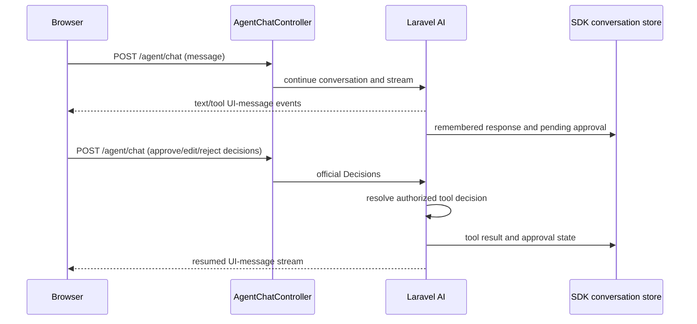

# Architecture

## Application boundary

Laravel 13, Inertia 3, Vue 3, TypeScript, Tailwind 4 and Vite form a reusable
starter kit. Web pages and the minimal JSON API share the local
`packages/thinkycz/laravel-core` helpers. SSR, the old catalog/order domain and
OpenAPI demo generation remain deliberately deferred.

## Authentication and validation

Both HTTP surfaces use encrypted database-token cookies, queued cookies and
Laravel sessions. Cookies are HTTP-only, host-only and SameSite Lax; outside
local/testing, secure cookies use compatible `__Host-` attributes. An existing
explicit bearer token remains supported. Logout revokes the current token;
password reset completion revokes all account tokens. Automatic token expiry
remains deferred; tokens do not acquire expiry merely because a cookie expires.

Cookie API clients first call `GET /api/v1/auth/csrf` (204) to initialize session
and CSRF cookies, then include the decoded XSRF token with mutations. Login and
registration also require request-forgery protection. Only a successfully
authenticated explicit bearer token qualifies for exemption. CORS defaults to
same-origin access; `TRUSTED_ORIGINS` supplies an explicit comma-separated list
when cross-origin browser access is required. It does not disable CSRF checks.

Inertia `<Form>` is the canonical form component. Validation follows Laravel's
redirect-and-session flow: validation failure redirects to the previous page,
Inertia shares session errors, and `<Form>` displays its errors. There is no
path-to-component mapping or custom Inertia 422 page response. JSON API clients
continue to receive structured validation errors with status 422.

Password recovery sends reset links only. Requesting a link does not change the
password or revoke tokens. Completing recovery validates and consumes the reset
token and atomically changes the password and revokes authentication tokens.
Changing an email address clears verification; leaving it unchanged preserves
verification. Successful email-verification tokens are consumed. Notifications
are queued after transaction commit.

## SDK-owned AI conversations and approvals

The selected architecture follows Laravel AI's official conversation and tool
approval flow. `ChatAgent` uses `RemembersConversations`; the SDK is the sole
message-persistence owner. `User` uses `HasConversations`, and repository queries
scope ownership through that polymorphic participant relation. Do not add a
second application message writer beside SDK remembering.

`POST /agent/chat` accepts either a normal `message` or ID-keyed approval
`decisions`, together with the existing `conversation_id` when continuing. An
unknown or foreign conversation fails ownership checks. The response streams the
SDK's Vercel UI-message protocol directly and exposes `x-conversation-id`; the
browser adopts that canonical ID before the next turn. The frontend uses
`@ai-sdk/vue` and the AI SDK transport rather than the former run bridge.

`SendTestNotificationTool` implements `Approvable`. A pending notification exposes
its subject and message for approval, editing, or rejection. Approval resumes the
SDK tool call; it is not a new user-message turn. The tool receives its recipient explicitly from the conversation participant and
queues a notification using `ShouldQueue` and dispatch after commit. It does not
resolve a mutable global guard while executing.
Stored tool calls, results and `approval_state` restore approval cards on refresh.
The custom clarification tool and clarification next-turn workflow are removed.

SDK remembering limits provider history to its latest 100 stored messages and
uses ordered identifiers. Repository UI history independently selects the latest
100 rows, and the sidebar selects at most 50 conversations. Older history is
not currently exposed through a pagination UI. SDK
approval result recording does not by itself prove exactly-once external side
effects under concurrent requests or process crashes; integration tests must
exercise those boundaries explicitly.

## Direct streaming and persistence limits

The former durable runs, run events, assistant placeholders, active-run key,
replay cursors, queued provider jobs and reconciliation job are removed. There is
no queued/running/terminal server state machine, durable reconnect replay, or
cancellation endpoint. Browser Stop aborts transport; it is not an acknowledged
server cancellation transaction. Refresh restores SDK-persisted messages and
pending approvals, not an in-flight run snapshot.

SDK remembering writes at its response boundary. Do not claim that partial
failed/aborted output is durable or that a user/assistant pair is committed
atomically without a regression test demonstrating that behavior. There are no
application per-delta content updates or replay-event writes. The SDK retains
stream events in memory until the response finishes; this remains distinct from
the removed application event buffer. Query-count results
from the deleted buffered-run implementation do not certify this implementation.

Application guards must protect ownership, concurrent approval submission,
conversation deletion and account deletion around the SDK flow. Polymorphic
participants cannot rely on a direct `users` foreign key alone. Conversation
message foreign keys and explicit account cleanup have different responsibilities.
Do not infer participant cleanup from the `HasConversations` relation declaration.

The controller serializes conversation requests with a 180-second cache lease and
validates decisions against the current pending IDs while holding it. Normal
messages cannot bypass a pending approval. `SafeChatResponse` leaves SDK
remembering intact while sanitizing provider and failed-tool events, checking
elapsed time/disconnection at event boundaries, and checking conversation
existence periodically. Provider calls have a 90-second timeout; the wrapper also
checks a 90-second elapsed deadline when events arrive. A blocked provider call
cannot be interrupted merely by that event-boundary check.

Unexpected setup errors return a safe 502 response; stream exceptions produce a
safe error event and release the lease. The callback temporarily ignores automatic
PHP user-abort termination so its disconnect check and `finally` cleanup can run,
then restores the previous setting. This cleanup is not durable cancellation.
Null approval reasons are omitted from
the wire payload because AI SDK 7 accepts absence but rejects a null reason.
These adaptations do not close the process-crash gap between an approved tool's
external side effect and the SDK approval-result checkpoint. Do not claim
exactly-once notification delivery across that gap.

## Runtime services and browser behavior

Provider execution happens in the HTTP streaming request. Queue workers remain
necessary for approved notification delivery and other queued application mail;
they do not run or recover chat generations. Local jobs use the database queue,
and deployed jobs use Redis. Worker/visibility timeout configuration is distinct
from HTTP/provider request timeout and reverse-proxy buffering limits.

The browser keeps its canonical conversation ID and SDK message parts synchronized
with navigation and persisted history. Connection failure, pending approval,
rejection and transport cancellation have different UI states. Pending approvals
must not be silently reissued after refresh. Dialogs require names, focus
trapping/restoration, Escape dismissal and blocked background interaction. Enter
sends, Shift+Enter inserts a newline, and IME composition does not submit.
User-facing strings stay synchronized in en/cs/sk.

## Verification boundary

Pest selects isolated configuration before bootstrap and does not clear developer
caches. Playwright owns its temporary SQLite database, file sessions and fixed
server; it never reuses the developer's server. Tests use fake providers and mail
and block external requests. Cleanup removes only test-owned artifacts.

Tests must exercise the official approval loop with fake transport where tool
execution matters: `ChatAgent::fake()` bypasses parts of the real approval
resumption path. Cover approve, edit, reject, stale/foreign IDs, refresh, concurrent
submissions, deletion, safe errors and transport abort without a paid provider.
The removed run/clarification suites are not evidence for this architecture.

Generator contracts still create disposable CRUD code, analyze it with strict
PHPStan, and exercise ownership/pagination. Architecture scans are recursive and
complement behavioral tests. `make check` and `make e2e` are separate checks;
disposable MySQL/Redis and deployment verification must target current contracts.
Final results belong in the integration handoff. Live provider behavior and a
real deployment remain unverified; this is not production certification.
