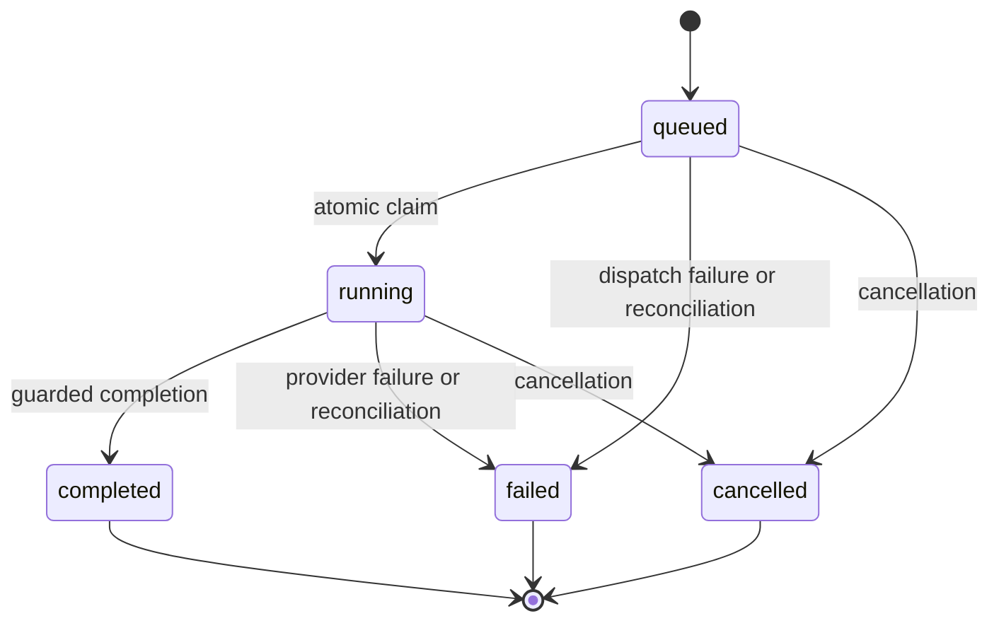

# Architecture

## Application boundary

Laravel 13, Inertia 3, Vue 3, TypeScript, Tailwind 4 and Vite form a reusable
starter kit. Web pages and the minimal JSON API share the local
`packages/thinkycz/laravel-core` helpers. SSR, the old catalog/order domain and
OpenAPI demo generation remain deliberately deferred.

## Authentication and validation

Both HTTP surfaces use encrypted database-token cookies, queued cookies and
Laravel sessions. Cookies are HTTP-only, host-only and SameSite Lax; outside
local/testing, secure cookies use compatible `__Host-` attributes. An existing
explicit bearer token remains supported. Logout revokes the current token;
password reset completion revokes all account tokens. Automatic token expiry
remains deferred; tokens do not acquire expiry merely because a cookie expires.

Cookie API clients first call `GET /api/v1/auth/csrf` (204) to initialize session
and CSRF cookies, then include the decoded XSRF token with mutations. Login and
registration also require request-forgery protection. Only a successfully
authenticated explicit bearer token qualifies for exemption. CORS defaults to
same-origin access; `TRUSTED_ORIGINS` supplies an explicit comma-separated list
when cross-origin browser access is required. It does not disable CSRF checks.

Inertia `<Form>` is the canonical form component. Validation follows Laravel's
redirect-and-session flow: validation failure redirects to the previous page,
Inertia shares session errors, and `<Form>` displays its errors. There is no
path-to-component mapping or custom Inertia 422 page response. JSON API clients
continue to receive structured validation errors with status 422.

Password recovery sends reset links only. Requesting a link does not change the
password or revoke tokens. Completing recovery validates and consumes the reset
token and atomically changes the password and revokes authentication tokens.
Changing an email address clears verification; leaving it unchanged preserves
verification. Successful email-verification tokens are consumed. Notifications
are queued after transaction commit.

## AI persistence and lifecycle

Application repositories/services own conversation persistence. `ChatAgent`
receives explicit conversational context and does not use SDK automatic
remembering. A start transaction creates one submitted user message, one
assistant placeholder and one run. Provider context includes at most the latest
100 completed prior messages; the current prompt is appended once.

A nullable unique active-conversation key permits one active run per conversation.
Claim and terminal transitions are guarded; duplicate delivery cannot invoke the
provider again. Completion and cancellation compete through the same guard, so
terminal states never change again. Provider calls execute outside database
transactions. User and conversation context are passed explicitly, without
mutating a global authentication guard.

Message content, run cursor and replay events are persisted together. Text is
buffered until the next delta after 100 ms, 4 KiB, or termination. Snapshots read
consistent content and cursor values. Replay batches are bounded. Tool results,
usage metadata and partial failed/cancelled responses survive refresh. Errors
exposed to clients are safe translated codes/messages; diagnostics stay in
server reporting.

User, conversation, message, run and event relationships cascade on deletion.
Workers guard writes against deletion and terminal transitions. An unknown or
foreign conversation ID fails rather than creating a replacement conversation.

## Queue and recovery

Local asynchronous execution uses the database queue; deployed environments use
Redis. PHP unit/feature tests normally use a synchronous fake queue, while browser
lifecycle tests run a real worker against an isolated database queue with fake
providers. Provider timeout is 90 seconds, worker timeout 120 seconds and retry
visibility 180 seconds. Provider execution has one automatic attempt; a user
retry creates a new run.

The scheduler dispatches a reconciliation job for queued runs older than five
minutes and running runs older than 150 seconds. It uses guarded failure
transitions. A worker alone does not replace the scheduler: both must run for
recovery after process termination.

## Browser state

The shared `active_run` snapshot identifies its conversation and assistant
message and carries server status, content, cursor and safe error information.
The returned conversation ID becomes canonical immediately. Navigation follows
that ID; obsolete stream subscriptions are aborted and ignored. Streaming
snapshots update the existing assistant placeholder.

Connection state is separate from server run status. Reconnection exhaustion
allows retry, and cancellation remains pending until acknowledged. Clarification
payloads are persisted and rendered with `ClarificationCard`; a selection starts
a normal next turn in the same conversation and is recorded to prevent duplicate
selection after refresh. Typed answers remain valid next turns.

Dialogs provide naming, focus trapping/restoration, Escape dismissal and blocked
background interaction. Enter sends a prompt; Shift+Enter inserts a newline;
IME composition does not submit. User-facing states stay synchronized in en/cs/sk.

## Verification boundary

Pest selects its isolated configuration before application bootstrap and does not
clear developer caches. Playwright owns a temporary SQLite database, file-backed
sessions and fixed test server; it cannot reuse the developer's server. AI/mail
providers are fake and external requests are blocked. Cleanup removes only
artifacts owned by that test run.

Generator contracts create a disposable complete CRUD slice, analyze generated
code with the project's strict PHPStan configuration, and exercise ownership and
pagination. Architecture scans are recursive; they complement behavioral tests
and do not establish universal ownership or concurrency correctness.

`make check` covers static analysis, formatting, audits, build, Vitest and Pest.
`make e2e` runs the isolated browser suite separately. MySQL uniqueness, foreign
keys and concurrent transitions, Redis recovery and deployment sequencing need
specific disposable-environment verification. Passing local tests is not
production certification or evidence of live provider behavior.
