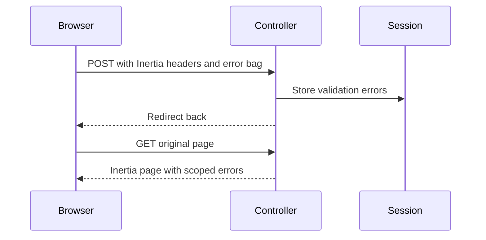

# Architecture

## Application surfaces

Laravel 13 and the local `packages/thinkycz/laravel-core` package serve Inertia web pages and a compatible JSON:API auth surface. Vue 3 Composition API pages are resolved lazily by Vite. PHPStan remains at maximum strictness; TypeScript rejects unused code.

Web controllers render Inertia pages or redirect after writes. API controllers remain invokable `AutomaticController` classes. Both use core validity, resolver, guard, and typed model APIs. Routes are registered through the core route registrar.

## Validation and forms

Web validation follows the Inertia redirect contract. Laravel redirects with session errors; Inertia shares those errors on the subsequent GET. `WebForm` submits using `router.post`, applies an action-specific error bag, disables duplicate submits, and exposes local errors/pending state to its slot. Password values are excluded from flashed input. JSON API clients still receive 422 JSON errors.

Success notices use `Inertia::flash` and survive guest redirect chains. Multi-step database writes are transactional; queued notifications dispatch after commit.

## Authentication and account data

The `database_token` guard stores hashed bearer secrets and accepts HTTP-only cookies or bearer headers. Tokens have absolute expiry, last-used time, and bounded browser metadata. Cookies use SameSite Lax, secure `__Host-` names outside local/testing, and the same lifetime as tokens. Authentication rejects expired tokens. A daily scheduled job dispatches bounded per-token pruning work.

The additive token migration preserves existing hashes and grants existing sessions a configured transition period (30 days by default). Sessions are listed through the authenticated user's relationship; expired and foreign tokens are omitted, and no secrets are serialized. Revocation confirms the password and cannot target the current session. Logout revokes the current token; changing a password revokes all tokens and returns to sign-in.

Email changes invalidate verification and old reset links inside the profile transaction. Initial registration and changed email send queued verification notices. Recovery uses reset links and the same neutral response for unknown accounts. Recovery and verification resends retain valid-request throttle hits; invalid input does not consume quota.

Account deletion uses a shared model operation for both surfaces, removing reset credentials, database tokens, owned conversations/messages, and the user transactionally. Web deletion additionally confirms the current password and invalidates the browser session. Existing API request contracts remain compatible.

## Shell and assistant

The application shell exposes Overview, optional Assistant, and Settings, including mobile navigation, active states, focus-managed dialogs, and device-local system/light/dark appearance. Theme initialization runs before assets paint. App branding and page titles use `APP_NAME`. Both backend and frontend translations keep en/cs/sk parity.

`AI_ENABLED=false` is the installation default. Disabled routes return 404 and shared props avoid conversation queries. Typed `features` props describe availability. History is shared only on assistant/conversation pages. The Vue AI client lives in the lazy assistant chunk.

The assistant uses Laravel AI 1 with the Vercel stream protocol and approval decisions. Owned conversation lookup precedes continuation. Approval IDs must match the latest pending approvals; replay after completion is rejected. The SDK persists approval results and masks provider stream exceptions. Client interruption cancels the pending request and restores the composer.

The original conversation migration now creates a compatible schema or fails before modifying incompatible legacy tables. The additive SDK upgrade converts old tool calls/results/approval state into steps and status while retaining old columns and message content. Legacy data is never automatically dropped.

## Test and release boundaries

Ordinary PHP tests load `tests/environment.env` with forced in-memory SQLite, array cache/mail/session, and sync queues; they neither load local credentials nor clear application caches. Playwright creates temporary databases, separate servers, isolated file cache/sessions, and captured mail. Integration tests explicitly target `starter_integration_tests` and namespaced Redis keys.

Lockfiles are tracked. Node 24 is standardized in `.nvmrc`, package engines, types, and CI. Composer resolves against PHP 8.3 while retaining Pest 4/PHPUnit 12. Release targets install dev tooling, build assets, migrate, prune dev dependencies, and optimize in that order. Demo seeding is a separate local-only action.
